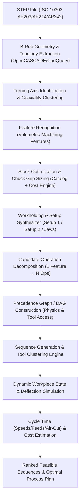
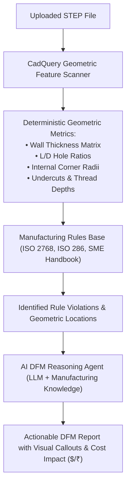

# MECHmetrIQ — Advanced Turning Process Planning (CAPP) & AI Architecture

> **Document Type:** Algorithm Design Specification & Implementation Blueprint  
> **Industrial Standards:** ISO 10303 (AP203/AP214/AP242), ISO 286-1/2, ISO 2768-1/2, ISO 21920:2021, ISO 1832, ASME Y14.5-2018, DIN 6885, DIN 471  
> **Target Subsystems:** CAD Parsing (`services/smartquote`), CAPP Engine (`process_planning`), Quoting Engine (`pricing.ts`), and AI Modules (AI-CAD & AI-DFM).

---

## 1. System Pipeline Architecture

To transition MECHmetrIQ from simple geometry heuristics to true **Computer-Aided Process Planning (CAPP)**, we establish a formal, multi-stage manufacturing pipeline:



---

## 2. Algorithmic Breakdown: Items 1 to 17

### 1) Primary Turning Axis Determination & Coaxiality
* **The Problem:** Imported STEP files frequently arrive in arbitrary coordinate orientations $(u_x, u_y, u_z)$ rather than aligned with the machine lathe spindle axis ($Z$).
* **CadQuery/OpenCASCADE Implementation:**
  1. **Surface Inspection:** Query all faces for analytical rotational surfaces: `GeomAbs_Cylinder`, `GeomAbs_Cone`, `GeomAbs_Toroid`, and `GeomAbs_SurfaceOfRevolution`.
  2. **Axis Extraction:** For every cylindrical face $f_i$, extract the axis line $L_i = (P_i, \vec{a}_i)$, where $P_i$ is an arbitrary point on the axis and $\vec{a}_i$ is the unit direction vector.
  3. **Parallelism Check (ISO 1101 Angular Tolerance):** Group faces into parallel clusters where:
     $$|\vec{a}_i \cdot \vec{a}_j| \ge \cos(\theta_{\text{tol}}) \quad (\theta_{\text{tol}} \le 0.5^\circ \implies |\vec{a}_i \cdot \vec{a}_j| \ge 0.99996)$$
  4. **Coaxiality Check (ISO 286 / ASME Y14.5 Coaxiality):** Two parallel cylindrical faces $L_1, L_2$ are coaxial if the radial distance between their axes is near zero:
     $$\text{dist}(L_1, L_2) = \|(P_2 - P_1) - ((P_2 - P_1) \cdot \vec{a}_1)\vec{a}_1\| \le \delta \quad (\delta \le 0.05\,\text{mm})$$
  5. **Dominance Scoring:** The true turning spindle axis $\vec{A}^*$ is chosen by maximizing cumulative coaxial cylindrical surface area:
     $$\vec{A}^* = \arg\max_{\vec{A}_k} \sum_{f_i \in \text{CoaxialCluster}(k)} \text{Area}(f_i)$$
  6. **Rotational Symmetry Ratio:** Verify that the part is genuinely suitable for a lathe. Calculate the surface area fraction that is rotationally symmetric around $\vec{A}^*$. If $\ge 80\%$, route directly to CNC Turning / Mill-Turn.

#### 💡 Cartesian vs. Cylindrical Coordinate Systems
* **Will Cylindrical Coordinates $(r, \theta, z)$ give better results?**
  * **Yes, significantly.** In Cartesian $(x,y,z)$, an outer cylinder is an implicit nonlinear equation $x^2 + y^2 = R^2$.
  * In a Cylindrical system oriented along spindle axis $\vec{A}^*$ with $r = \sqrt{x^2 + y^2}$:
    1. **Rotational Symmetry Verification:** A pure turned surface satisfies $\frac{\partial r}{\partial \theta} = 0$. Any non-turned feature (cross-holes, keyways, milled flats) immediately flags wherever $\Delta r(\theta) \ne 0$.
    2. **Dimension Reduction ($3\text{D} \to 2\text{D}$):** The entire 3D rotational solid projects into a clean 2D $(r, z)$ half-profile polygon. All lathe toolpaths, roughing passes, and facing operations execute in this 2D plane, reducing computational geometry overhead from $\mathcal{O}(N_{\text{mesh}})$ to $\mathcal{O}(M_{\text{profile}})$.
    3. **Stock & Bore Validation:** Inner and outer workpiece boundaries are represented as clean functions $r_{\text{in}}(z)$ and $r_{\text{out}}(z)$.

---

### 2 & 3) Finished Maximum Diameter & Finished Overall Length
From the 2D projected profile in $(r, z)$ space:
* **Max Finished Diameter ($D_{\text{finish}}$):** $2 \times \max(r)$ across all model vertices and cylindrical radii.
* **Finished Overall Length ($L_{\text{finish}}$):** $z_{\max} - z_{\min}$ along the turning axis $\vec{A}^*$.

---

### 4 & 5) Stock Sizing & Commercial Catalog Cost Optimization
* **Allowances Required (per SME Handbook & ISO 2768):**
  1. **Radial Machining Allowance ($\delta_r$):** $1.0\text{--}2.5\,\text{mm}$ on radius ($2\text{--}5\,\text{mm}$ on diameter) to cut beneath the rough mill scale, decarburized outer layer, and runout.
  2. **Front Facing Allowance ($L_{f1}$):** $1.0\text{--}2.0\,\text{mm}$ for Setup 1 datum facing.
  3. **Rear Facing Allowance ($L_{f2}$):** $1.0\text{--}2.0\,\text{mm}$ for Setup 2 cleanup to exact length.
  4. **Parting Blade Allowance ($L_{\text{part}}$):** $3.0\text{--}5.0\,\text{mm}$ (standard cut-off insert width + side clearances).
  5. **Chuck Grip Length ($L_{\text{grip}}$):** Material clamped inside the jaws (see Item 8).

$$\text{Min Feasible Diameter: } D_{\min} = D_{\text{finish}} + 2 \cdot \delta_r$$
$$\text{Min Cut Bar Length: } L_{\text{stock}} = L_{\text{finish}} + L_{f1} + L_{f2} + L_{\text{part}} + L_{\text{grip}}$$

* **Catalog Matching & Cost Engine (The Diameter Selection Paradox):**
  * *Example:* If $D_{\min} = 41.5\,\text{mm}$, Ø42 mm bar minimizes chip removal. However, in India, cold-drawn Ø45 mm (in EN8 / AISI 1045 or Al 6061-T6) is a mass-produced standard stock size, stocked locally at lower ₹/kg, whereas Ø42 mm is non-standard, incurring custom procurement premiums and longer lead times.
  * **Objective Function:**
    $$\min_{D \in \text{Catalog}, D \ge D_{\min}} \text{Cost}(D) = \left[ \frac{\pi}{4} D^2 \cdot L_{\text{stock}} \cdot \rho \cdot \text{PricePerKg}(D) \right] + \left[ \frac{V_{\text{removed}}(D)}{\text{MRR}} \times C_{\text{machine}} \right]$$
  * The algorithm selects candidate diameters within $[D_{\min}, D_{\min} + 15\,\text{mm}]$ from the database catalog and chooses the true lowest total cost.

---

### 6, 7 & 8) Initial Gripping Surface, Setup 1, & Minimum Grip Length

```
             ┌───────────────────── CHUCK JAWS ────────────────┐
             │  ◄──────────── L_grip ───────────►              │
  ═══════════╧════════════════════════════════════╧═════════════╤═════════════════════════════
  STOCK OD   [   Chuck Jaw Clamping Zone       ]  Machining    │  Finished Turned Part 
  ═══════════╤════════════════════════════════════╤═════════════╧═════════════════════════════
             │                                                 │
```

* **Surface Selection Rules:**
  1. **Raw Stock OD vs. Pre-machined Land:** In Setup 1 (Op 10), clamping occurs on raw bar stock OD or a clean saw-cut diameter.
  2. **Torque Transmission Capacity:** Jaws gripping on larger diameters generate higher clamping torque ($T = \mu \cdot F_{\text{clamp}} \cdot \frac{D}{2}$), preventing part slippage under heavy roughing cuts.
  3. **Thin-Wall Deformation Prevention:** If the gripping zone contains an internal bore, calculate hoop stress and radial deflection under clamping force $F_c$:
     $$\delta_{\text{wall}} \approx \frac{F_c \cdot R^3}{E \cdot I_{\text{wall}}} \quad \text{Verify: } \delta_{\text{wall}} < \text{Elastic Limit}$$
     If wall thickness $t < 1.5\,\text{mm}$, flag a clamping deformation risk.
  4. **Minimum Grip Length Formula:**
     $$L_{\text{grip}} \ge \max\left( L_{\text{jaw\_min}}, \, 0.25 \times D_{\text{stock}}, \, 15.0\,\text{mm} \right)$$
  5. **Overhang Moment Equilibrium:** Verify holding moment against cutting force $F_c$:
     $$M_{\text{overhang}} = F_c \times L_{\text{stickout}} \le \mu \cdot F_{\text{clamp}} \cdot \frac{L_{\text{grip}}}{2}$$

---

### 9, 10 & 11) Number of Setups, 2nd Setup Gripping, & Workholding Feasibility
* **Setup Count Logic:**
  * **2 Setups (Standard Lathe):** Op 10 turns front profile and internal bore; Op 20 parts off or flips workpiece to face the rear datum and deburr.
  * **3+ Setups (Turn + Mill):** Required if off-axis cross-holes, keyways (DIN 6885), or radial bolt circles exist and no live-tooling turret is available.
* **Setup 2 Gripping Rules:**
  * Must grip on a precision-turned OD diameter produced in Setup 1.
  * Must specify **Soft Jaws** (bored to the exact turned diameter) to avoid marring finished surfaces and maintain runout $\le 0.015\,\text{mm}$.
* **Workholding Stability & Support Criteria (SME Guidelines):**
  * Overhang ratio $\lambda = \frac{L_{\text{stickout}}}{D_{\text{grip}}}$:
    * $\lambda \le 3$: Standard 3-jaw chuck (unsupported overhang).
    * $3 < \lambda \le 6$: Chuck + Tailstock Live Center (requires center drill op in Setup 1).
    * $\lambda > 6$: Chuck + Tailstock + Steady Rest / Follower Rest to prevent chatter and bending deflection ($\delta = \frac{F_c L^3}{3 E I}$).

---

### 12 & 13) Feature Recognition vs. Candidate Operations Decomposition
A **Feature** is a geometric CAD attribute; an **Operation** is a discrete manufacturing step.

| Detected Feature (B-Rep) | Geometric Validation | Stock Status | Candidate Operation Set |
|---|---|---|---|
| **Center Axial Hole** | Blind vs. Through; Depth-to-Dia ($L/D$) | Solid Bar vs. Hollow Tube | 1. Spot Drill (90°/120°)<br>2. Twist Drill / Indexable U-Drill<br>3. Rough Boring Bar (ISO 5608)<br>4. Finish Boring Bar (ISO 286 IT7)<br>5. Internal Chamfer |
| **External Stepped OD** | Cylindrical land + planar shoulder | Solid Bar | 1. Facing Pass (Datum $Z=0$)<br>2. OD Rough Turning (multi-pass axial)<br>3. OD Finish Contour (single-pass)<br>4. Edge Fillet / Chamfer |
| **External Groove** | Recessed diameter between two shoulders | Solid Bar | 1. Rough Grooving (peck plunge)<br>2. Finish Profiling Grooving |
| **Threading Land** | Cylindrical surface with thread annotation | Solid Bar | 1. OD Turn to nominal thread major dia<br>2. Metric Threading Pass (ISO 965 multi-pass) |

* **Tooling Feasibility Checks:**
  * **Boring Bar Clearance:** Hole entry diameter must clear tool shank ($D_{\text{bore}} \ge 1.25 \times D_{\text{bar}}$); overhang must respect $L_{\text{hole}} / D_{\text{bar}} \le 4$ for steel shanks and $\le 7$ for anti-vibration carbide shanks.
  * **Standard Drill Availability:** Check hole diameter against standard metric drill catalogs ($0.5\,\text{mm}$ increments up to Ø20 mm). If non-standard (e.g. Ø22.3 mm), automatically sequence: *Drill Ø20 $\to$ Single-point bore to Ø22.3 mm*.

---

### 14, 15, 16 & 17) Operation Precedence, Dynamic Workpiece State & Sequence Optimization

```
                  ┌────────────────────────┐
                  │ OP 10: Setup 1 (Chuck) │
                  └───────────┬────────────┘
                              │
               ┌──────────────┴──────────────┐
               ▼                             ▼
     [Precedence Tier 1]            [Precedence Tier 1]
     Facing Datum Z=0               OD Roughing (Skin pass)
               │                             │
               └──────────────┬──────────────┘
                              ▼
                     [Precedence Tier 2]
                     Center / Spot Drill
                              │
                              ▼
                     [Precedence Tier 3]
                   Drill (Ø20 Rough Hole)
                              │
               ┌──────────────┴──────────────┐
               ▼                             ▼
      [Precedence Tier 4]           [Precedence Tier 4]
        OD Semi-Finish                 ID Rough Bore
               │                             │
               └──────────────┬──────────────┘
                              ▼
                     [Precedence Tier 5]
                  Grooving / Threading / Finish
                              │
                              ▼
                  ┌────────────────────────┐
                  │ OP 20: Setup 2 (Flip)  │
                  └───────────┬────────────┘
                              ▼
                     Facing to Final Length
```

* **Physical Precedence Rules:**
  1. *Datum First:* Face the outer reference datum before axial drilling or OD profiling.
  2. *Rough before Finish:* All roughing cuts must precede finishing to relieve residual manufacturing stresses.
  3. *Drill before Bore:* Internal boring requires a pre-existing drilled starting hole.
  4. *Rigidity Preservation:* Rough heavy external diameters *before* boring internal cavities to maintain part stiffness and avoid thin-wall vibration.
  5. *Threading / Parting Last:* Threading occurs after finish OD turning; cut-off/parting occurs at the very end of Setup 1.
* **Tool Clustering (Turret Index Minimization):**
  * Group operations by tool ID: Roughing Tool (e.g. CNMG 120408) executes facing and all external rough steps before indexing the turret.
* **Dynamic Workpiece State Tracking:**
  * Track remaining wall thickness $t_{\min}(k) = \min(r_{\text{OD}}(z, k) - r_{\text{ID}}(z, k))$ at step $k$.
  * If $t_{\min}(k) < 1.5\,\text{mm}$, flag thin-wall vibration risk; reduce cutting speed and feed by $30\%$, or sequence operations so the wall is supported as long as possible.
* **Pareto Ranking Engine:**
  * For all valid topological sorts of the precedence DAG, calculate total cost:
    $$\text{Total Cost} = \sum (\text{Machining Time} \times \text{Rate}) + (N_{\text{tool\_changes}} \times T_{\text{index}} \times \text{Rate}) + (N_{\text{setups}} \times C_{\text{setup}})$$
  * Select the global optimal sequence.

---

## 3. AI-Assisted CAD Modelling

### Practical Architecture & Implementation
Direct generation of binary STEP files from an LLM is error-prone. The proven, reliable industrial standard is **Prompt-to-CadQuery DSL**:


### Core Capabilities:
1. **Prompt-to-B-Rep Generation:**
   * Example: *"Generate an ISO 286 H7 flanged bearing bush with 50mm OD, 30mm bore, 70mm flange OD, 12mm flange thickness, 45mm overall length, and 4 x M6 counterbores on 55mm PCD."*
   * The LLM writes clean CadQuery Python code, the backend kernel compiles it into an exact STEP AP242 solid, validates watertightness, and serves the 3D model.
2. **Standard Machine Element Insertion:**
   * Automatically insert standard features conforming to industrial catalogs:
     * O-ring grooves according to **ISO 3601**.
     * Circlip / retaining ring grooves according to **DIN 471** (shafts) and **DIN 472** (bores).
     * Parallel drive keyways according to **DIN 6885 / ISO 773**.
3. **Parametric De-featuring:**
   * Automatically suppress cosmetic text, small chamfers, and non-functional fillets to accelerate process simulation and quoting.

---

## 4. AI-Assisted DFM (Design for Manufacturability) Review

### Dual-Layer Architecture:
Combining deterministic rule verification with plain English AI explanations:



### Deterministic Checks Performed:
1. **Deep Hole Ratio ($L/D > 8$):** Standard twist drills wander and vibrate at $L/D > 8$; flag requirement for peck drilling, gun-drilling, or lathe two-sided setups.
2. **Thin Walls ($< 0.8\,\text{mm}$ metals, $< 1.5\,\text{mm}$ plastics):** Prevents part warping under cutting tool force and chuck jaw pressure.
3. **Internal Turning Corner Radii ($R < 0.4\,\text{mm}$):** Standard turning inserts have nose radius $r_\epsilon \in \{0.4, 0.8, 1.2\}\,\text{mm}$. Sharp internal corners require special undercuts or grooving operations.
4. **Tool Reach & Interference:** Check if deep ID grooves or undercuts exceed standard tool reach.

### The AI Advantage:
* **Plain English Cost & Risk Explanation:** Instead of a vague error `"Wall thickness 0.5mm at Face 38"`, the system explains:
  > *"⚠️ **Thin Wall Warning (Rear Bore):** The remaining wall thickness is 0.5 mm in 6061-T6 Aluminum. Standard cutting tool pressure will cause vibration, chatter, and taper error. Increasing wall thickness to 1.0 mm allows standard machining speeds, reducing cycle time and saving approximately **₹220 per part**."*
* **Click-to-Fix Remediation:** Proposes the exact parametric fix in CadQuery for instant one-click model updating.

---

## 5. Implementation Roadmap & Milestones

| Phase | Milestone | Core Deliverables | Timeframe |
|---|---|---|---|
| **Phase A** | **Turning CAPP Core** | • Cylindrical face axis clustering & coaxiality detection.<br>• Cylindrical coordinate $(r, z)$ 2D slice extractor.<br>• Finished dimensions & catalog stock diameter optimizer. | Weeks 1–3 |
| **Phase B** | **Workholding & Grip Sizer** | • $L_{\text{grip}}$ calculator with clamping force & overhang formulas.<br>• Setup 1 / Setup 2 partitioner with soft-jaw verification.<br>• Tailstock live-center necessity check ($L/D > 3$). | Weeks 4–5 |
| **Phase C** | **Operation & Precedence DAG** | • Feature-to-Operation decomposition module.<br>• Directed Acyclic Graph (DAG) for operation precedence.<br>• Tool clustering & dynamic state stiffness tracking. | Weeks 6–8 |
| **Phase D** | **AI-Assisted DFM Module** | • Geometric DFM scanner (thin wall, deep bore, corner radius).<br>• LLM synthesis layer connecting violations to rupee/dollar cost impact. | Weeks 9–10 |
| **Phase E** | **AI CAD Modeling Copilot** | • CadQuery text-to-CAD generator & isolated execution sandbox.<br>• Interactive 3D WebGL viewer preview & STEP download. | Weeks 11–12 |
