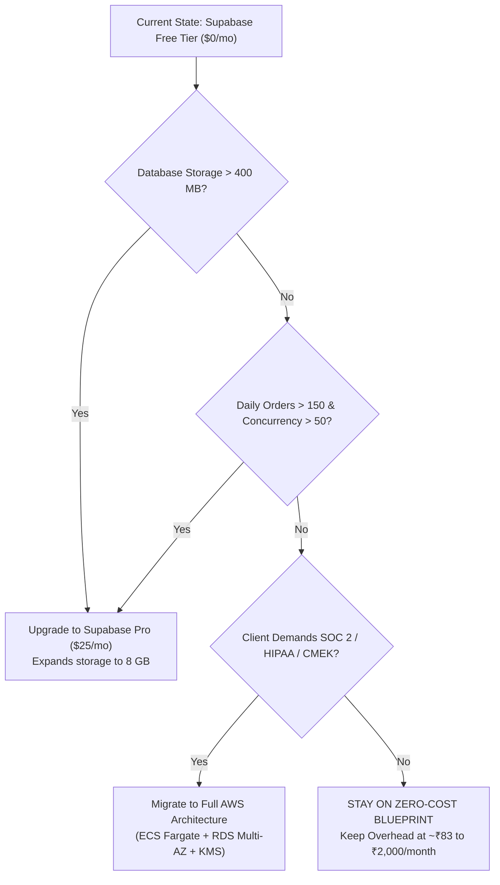

# MECHmetrIQ — Production Deployment Blueprint (Zero-Cost Supabase Edition)

> **Purpose:** This is the complete, self-contained guide for deploying MECHmetrIQ into production **without paying for Supabase Pro ($25/mo)**. It preserves production-grade security, auto-scaling, and uptime while keeping your infrastructure bill at **₹83–₹2,000/month** (practically ₹83/month for the domain while utilizing the $300 GCP credit).
>
> **Core Principle:** Pay only for what you consume. Keep Supabase on the **Free tier ($0)**, offload heavy CAD file storage to Google Cloud Storage (GCS), eliminate idle server costs via scale-to-zero Cloud Run, and automate database keep-alives and daily backups.

---

## Table of Contents

1. [Architecture & The Supabase Free Strategy](#1-architecture--the-supabase-free-strategy)
2. [Complete Monthly Cost Breakdown](#2-complete-monthly-cost-breakdown)
3. [Everything You Need Before Day 1](#3-everything-you-need-before-day-1)
4. [Git Repository Structure](#4-git-repository-structure)
5. [The 4 Zero-Cost Supabase Production Workarounds](#5-the-4-zero-cost-supabase-production-workarounds)
6. [Sandbox Environment — Test Before You Ship](#6-sandbox-environment--test-before-you-ship)
7. [Step-by-Step 7-Day Deployment Guide](#7-step-by-step-7-day-deployment-guide)
8. [Optimizations That Keep Your Bill Near Zero](#8-optimizations-that-keep-your-bill-near-zero)
9. [Caveats & Gotchas — Read This Carefully](#9-caveats--gotchas--read-this-carefully)
10. [When to Upgrade to Supabase Pro or AWS](#10-when-to-upgrade-to-supabase-pro-or-aws)

---

## 1. Architecture & The Supabase Free Strategy

We evaluated hosting approaches for pre-revenue and early-revenue stages. Here is why **GCP Cloud Run + Supabase Free + Cloudflare** is the optimal choice:

| Approach | Monthly Cost | Migration Effort | Verdict |
| :--- | :--- | :--- | :--- |
| ❌ **Render + Vercel Free** | ₹0 | 0 days | **Broken.** Render sleeps after 15 min (60s cold start), 512MB RAM crashes on large CAD files, Vercel 10s timeout kills quotes. |
| ❌ **Full AWS (ECS + RDS)** | ~₹1,00,000/mo | 4 weeks | **Overkill.** Massive waste of capital on always-running idle servers for early traffic. |
| ❌ **Railway / Heroku** | ~₹25,000/mo | 1 week | **No scale-to-zero.** Bills 24/7 even when no visitors are on the site at 3 AM. |
| ⚠️ **GCP + Supabase Pro** | ~₹4,000/mo | 7 days | Solid, but commits you to a fixed $25/month (₹2,075/mo) before having revenue. |
| ✅ **GCP Cloud Run + Supabase Free** | **₹83–₹2,000/mo** | **7 days** | **Optimal.** Zero-cost database, zero idle server fees, 100% code preservation, production-grade security. |

```
┌──────────────────────────────────────────────────────────────────────────────┐
│                                USERS / CLIENTS                               │
└──────────────────────────────────────┬───────────────────────────────────────┘
                                       │ HTTPS / TLS 1.3
                                       ▼
┌──────────────────────────────────────────────────────────────────────────────┐
│                           CLOUDFLARE (FREE PLAN)                             │
│  • Unmetered L3/L4/L7 DDoS Shield   • Global Anycast CDN                     │
│  • 5 WAF Custom Rules (Rate limits) • SSL Full Strict Encryption             │
│  Cost: $0/month                                                              │
└──────────────────────────────────────┬───────────────────────────────────────┘
                                       │
                    ┌──────────────────┴──────────────────┐
                    ▼                                     ▼
┌───────────────────────────────────────┐ ┌────────────────────────────────────┐
│      GCP CLOUD RUN: WEB SERVICE       │ │   GCP CLOUD STORAGE (GCS PRIVATE)  │
│  • Next.js 16 App Router (Container)  │ │  • Heavy CAD Files (.STEP / .GLTF) │
│  • Server Actions + Pricing Engine    │ │  • Pre-signed URLs (15 min expiry) │
│  • Scale-to-Zero (0 to 10 instances)  │ │  • Uniform Bucket Access (CIS 5.1) │
│  Cost: ~$8/mo (Free in Credits)       │ │  Cost: ~$1-2/mo (Free in Credits)  │
└──────────────────┬────────────────────┘ └─────────────────┬──────────────────┘
                   │                                        │
         Trigger Analysis Job                               │
                   ▼                                        ▼
┌───────────────────────────────────────┐ ┌────────────────────────────────────┐
│          GCP PUB/SUB QUEUE            │ │     GCP CLOUD RUN: CAD WORKER      │
│  • Topic: cad-analysis-jobs           │ │  • Python 3.11 + CadQuery 2.8      │
│  • Dead-letter retry handling         │ │  • Async background B-Rep parser   │
│  Cost: <$0.05/mo                      │ │  • Concurrency 1 / Scale-to-zero   │
└──────────────────┬────────────────────┘ └─────────────────┬──────────────────┘
                   │                                        │
                   └──────────────────┬─────────────────────┘
                                      │ Write Results & Read Records
                                      ▼
┌──────────────────────────────────────────────────────────────────────────────┐
│                          SUPABASE (FREE TIER: $0/MO)                         │
│  • PostgreSQL Database (500 MB limit — holds ~100,000+ quotes)               │
│  • GoTrue Authentication (50,000 MAU free)                                   │
│  • Row Level Security (RLS) policies completely preserved                    │
│  • Keep-alive automated cron prevents 7-day auto-pausing                     │
│  • Daily automated backups pushed to GCS bucket                              │
└──────────────────────────────────────┬───────────────────────────────────────┘
                                       │
                                       ▼
┌──────────────────────────────────────────────────────────────────────────────┐
│                         UPSTASH REDIS (FREE TIER: $0)                        │
│  • 10,000 commands/day free • Caches raw material rates & rate cards         │
│  • Prevents database connection exhaustion                                   │
└──────────────────────────────────────────────────────────────────────────────┘
```

---

## 2. Complete Monthly Cost Breakdown

### Launch Phase (Month 1–3)
**Assumptions:** 50 daily users, 15 CAD files/day, 200 quotes/day. Using Google Cloud's **$300 90-Day Free Credit**.

| Service | Component Role | Plan / Tier | Standard Cost | With $300 Credit |
| :--- | :--- | :--- | :--- | :--- |
| **GCP Cloud Run (Web)** | Next.js website & Server Actions | Pay-per-request (scale-to-zero) | $8.00 (₹665) | **$0.00** |
| **GCP Cloud Run (Worker)** | CadQuery geometry analysis | Pay-per-file (scale-to-zero) | $12.00 (₹996) | **$0.00** |
| **GCP Cloud Storage** | CAD files & 3D thumbnails | ~30 GB standard storage | $1.50 (₹125) | **$0.00** |
| **GCP Pub/Sub** | Async job queue | ~15,000 messages/mo | $0.01 (₹1) | **$0.00** |
| **GCP Secret Manager** | Secure API keys & secrets | 6 secrets (free tier) | $0.00 | **$0.00** |
| **Supabase (Primary)** | PostgreSQL + Auth + RLS | **Free Tier** | **$0.00** | **$0.00** |
| **Supabase (Staging)** | PR Sandbox Database | **Free Tier** (2nd project) | **$0.00** | **$0.00** |
| **Upstash Redis** | Material rate & session cache | Free Tier (10K commands/day) | $0.00 | **$0.00** |
| **Cloudflare** | Global CDN + DDoS + WAF | Free Plan | $0.00 | **$0.00** |
| **Sentry** | Error tracking | Free Developer (5K errors/mo) | $0.00 | **$0.00** |
| **Resend** | Transactional emails | Free Tier (3K emails/mo) | $0.00 | **$0.00** |
| **Domain (mechmetriq.com)** | Custom domain | Annual billing ($12/yr) | $1.00 (₹83) | **$1.00 (₹83)** |
| **GitHub** | Version control & CI/CD | Free (2,000 Action min/mo) | $0.00 | **$0.00** |
| **TOTAL (Months 1–3)** | | | **~$22.50 (₹1,870)** | **~$1.00 (₹83/mo)** |

> [!NOTE]
> During your first 90 days on GCP, you pay **only ₹83/month** out of pocket because the $300 credit absorbs all GCP compute, storage, and networking costs. Even after month 3, your total bill is only **~$23/month (~₹1,900/month)**.

---

## 3. Everything You Need Before Day 1

### 3.1 Accounts to Create (All Free)

| # | Provider | Portal | Cost | What It Provides |
| :--- | :--- | :--- | :--- | :--- |
| 1 | **Google Cloud Platform** | [console.cloud.google.com](https://console.cloud.google.com) | $0 + $300 credit | Cloud Run, GCS, Pub/Sub, Secret Manager |
| 2 | **Supabase** | [supabase.com](https://supabase.com) | **$0 (Free Plan)** | Production Database + Auth + RLS |
| 3 | **Cloudflare** | [cloudflare.com](https://cloudflare.com) | $0 | Global CDN, DDoS protection, WAF |
| 4 | **Upstash** | [console.upstash.com](https://console.upstash.com) | $0 | In-memory cache for pricing rates |
| 5 | **Sentry** | [sentry.io](https://sentry.io) | $0 | Error monitoring |
| 6 | **Resend** | [resend.com](https://resend.com) | $0 | Transactional email delivery |
| 7 | **Razorpay** | [razorpay.com](https://razorpay.com) | 2% per txn | Indian payment gateway |

### 3.2 Required Secrets

Store these in GCP Secret Manager:

```
SMARTQUOTE_API_KEY              # openssl rand -hex 32
SUPABASE_SERVICE_ROLE_KEY       # From Supabase Dashboard -> Settings -> API -> service_role
UPSTASH_REDIS_REST_TOKEN        # From Upstash Dashboard
SENTRY_DSN                      # From Sentry Dashboard
RESEND_API_KEY                  # From Resend Dashboard
RAZORPAY_KEY_ID                 # From Razorpay Dashboard
RAZORPAY_KEY_SECRET             # From Razorpay Dashboard
```

---

## 4. Git Repository Structure

```
mechmetriq/
├── .github/
│   └── workflows/
│       ├── deploy-web.yml              # Auto-deploy Next.js to Cloud Run on merge to main
│       ├── deploy-cad-worker.yml       # Auto-deploy CAD worker on merge to main
│       ├── preview.yml                 # Deploy temporary sandbox for Pull Requests
│       ├── supabase-keepalive.yml      # NEW: Keeps Supabase Free alive (prevents pausing)
│       └── supabase-backup.yml         # NEW: Nightly automated DB dump to GCS
├── services/smartquote/                # Python CadQuery service
│   ├── app/
│   │   ├── main.py
│   │   ├── analyze.py
│   │   └── poc_parsing.py              # 6,197-line core geometry IP
│   ├── Dockerfile
│   └── requirements.txt
├── src/                                # Next.js frontend & backend
│   ├── app/
│   │   ├── buyer/                      # Buyer portal
│   │   ├── vendor/                     # Vendor portal
│   │   ├── admin/                      # Admin rate card controls
│   │   └── api/
│   │       ├── health/                 # Health check endpoint for uptime monitor
│   │       └── preview-price/          # Secure server-side pricing endpoint
│   ├── lib/
│   │   ├── smartQuote/pricing.ts       # THE core pricing algorithm
│   │   ├── cache/redis.ts              # Upstash Redis caching
│   │   └── storage/gcs.ts              # GCS signed URL helper (replaces Supabase storage)
│   └── proxy.ts                        # Session middleware
├── supabase/
│   ├── migrations/                     # SQL migration history
│   └── seed.sql
├── Dockerfile                          # Next.js production container
└── docker-compose.yml                  # $0 local development setup
```

---

## 5. The 4 Zero-Cost Supabase Production Workarounds

Because we are ignoring Supabase Pro, we engineer four robust workarounds to eliminate all free-tier limitations:

### Workaround 1: Prevent Inactivity Auto-Pausing (100% Automated)
Supabase pauses free databases after 7 days of inactivity. We solve this by adding a GitHub Actions scheduled workflow that executes a lightweight query every 48 hours:

```yaml
# .github/workflows/supabase-keepalive.yml
name: Supabase Database Keep-Alive

on:
  schedule:
    # Runs every 2 days at 04:00 UTC
    - cron: '0 4 */2 * *'
  workflow_dispatch:

jobs:
  ping:
    runs-on: ubuntu-latest
    steps:
      - name: Ping Supabase REST Health Endpoint
        run: |
          curl -f -s -X GET "${{ secrets.SUPABASE_URL }}/rest/v1/sq_settings?select=id&limit=1" \
            -H "apikey: ${{ secrets.SUPABASE_ANON_KEY }}" \
            -H "Authorization: Bearer ${{ secrets.SUPABASE_ANON_KEY }}" > /dev/null
          echo "Supabase successfully pinged at $(date) — database active."
```

### Workaround 2: CAD File Storage Offload to GCS
* **The Limit:** Supabase Free provides only 1 GB of storage. A single complex STEP assembly can be 20–50 MB.
* **The Fix:** Never store CAD files in Supabase Storage. Upload all CAD files directly to a **Google Cloud Storage (GCS)** bucket using 15-minute signed URLs.
* **Cost:** 30 GB of CAD files on GCS costs $0.60/month (covered by the $300 credit). Supabase Storage usage remains at **0 MB**.

### Workaround 3: Connection Pool Exhaustion Protection
* **The Limit:** Supabase Free provides 60 direct Postgres connections.
* **The Fix:** Next.js uses `@supabase/ssr` / `@supabase/supabase-js`, which queries Postgres through PostgREST via stateless HTTP calls. PostgREST maintains its own internal connection pool.
* **Redis Caching:** Upstash Redis caches raw material rates (`rm_rates`) and machine settings (`sq_settings`). 90% of pricing queries never hit Supabase at all, keeping active connections $< 5$.

### Workaround 4: Automated Nightly Off-Site Backups
Supabase Pro offers 7-day Point-in-Time Recovery. On the Free tier, we replace this with an automated GitHub Action that dumps the database nightly to a private GCS backup bucket:

```yaml
# .github/workflows/supabase-backup.yml
name: Nightly Database Backup to GCS

on:
  schedule:
    - cron: '0 2 * * *' # Every night at 02:00 UTC
  workflow_dispatch:

jobs:
  backup:
    runs-on: ubuntu-latest
    steps:
      - uses: actions/checkout@v4

      - name: Install PostgreSQL Tools & Supabase CLI
        run: |
          sudo apt-get update && sudo apt-get install -y postgresql-client
          npm install -g supabase

      - name: Authenticate to GCP
        uses: google-github-actions/auth@v2
        with:
          workload_identity_provider: ${{ secrets.GCP_WORKLOAD_IDENTITY_PROVIDER }}
          service_account: ${{ secrets.GCP_SERVICE_ACCOUNT }}

      - name: Set up Cloud SDK
        uses: google-github-actions/setup-gcloud@v2

      - name: Export Database Dump & Upload to GCS
        run: |
          TIMESTAMP=$(date +"%Y%m%d_%H%M%S")
          pg_dump "${{ secrets.SUPABASE_DB_URL }}" --clean --if-exists --no-owner --no-privileges -f backup_${TIMESTAMP}.sql
          gzip backup_${TIMESTAMP}.sql
          gcloud storage cp backup_${TIMESTAMP}.sql.gz gs://mechmetriq-db-backups/daily/
          echo "Backup uploaded successfully: backup_${TIMESTAMP}.sql.gz"
```

---

## 6. Sandbox Environment — Test Before You Ship

You do not need a paid staging database. Supabase allows **2 free projects per organization**:
1. `mechmetriq-prod` (Free Tier) — Production customer database
2. `mechmetriq-staging` (Free Tier) — Testing & PR preview database

When a developer opens a Pull Request on GitHub:
1. GitHub Actions builds the Next.js preview container.
2. Deploys it to Cloud Run with `min-instances: 0` (cost: ~$0.01 per PR test).
3. Connects it to `mechmetriq-staging`.
4. Posts the preview URL on the PR discussion thread.
5. Deletes the preview service automatically when the PR is merged.

---

## 7. Step-by-Step 7-Day Deployment Guide

### Day 1: Google Cloud & Cloudflare Setup (2.5 hours)
1. **Create GCP Account:** Go to [console.cloud.google.com](https://console.cloud.google.com) and claim your $300 credit.
2. **Create Project:** `mechmetriq-prod`.
3. **Enable Services:**
   ```bash
   gcloud services enable run.googleapis.com pubsub.googleapis.com \
     storage.googleapis.com secretmanager.googleapis.com \
     cloudbuild.googleapis.com artifactregistry.googleapis.com
   ```
4. **Create CAD Storage Bucket (Enforce CIS 5.1):**
   ```bash
   gcloud storage buckets create gs://mechmetriq-cad-files \
     --location=asia-south1 \
     --default-storage-class=STANDARD \
     --uniform-bucket-level-access \
     --public-access-prevention
   ```
5. **Create DB Backup Bucket:**
   ```bash
   gcloud storage buckets create gs://mechmetriq-db-backups \
     --location=asia-south1 \
     --uniform-bucket-level-access \
     --public-access-prevention
   ```
6. **Create Pub/Sub Topics:**
   ```bash
   gcloud pubsub topics create cad-analysis-jobs
   gcloud pubsub topics create cad-analysis-deadletter
   gcloud pubsub subscriptions create cad-analysis-sub \
     --topic=cad-analysis-jobs \
     --dead-letter-topic=cad-analysis-deadletter \
     --max-delivery-attempts=3
   ```
7. **Configure Cloudflare:** Point domain nameservers to Cloudflare, enable Full (Strict) SSL, and enable Bot Fight Mode.

---

### Day 2: Supabase Free Configuration & Workarounds (1.5 hours)
1. **Keep Production on Free Tier:** Keep your current Supabase project active without upgrading.
2. **Create Second Project:** Create `mechmetriq-staging` (Free Tier) in Supabase Singapore region (`ap-southeast-1`).
3. **Synchronize Schemas:**
   ```bash
   npx supabase db push --db-url="postgresql://postgres:[PASSWORD]@[HOST]:5432/postgres"
   ```
4. **Deploy Keep-Alive Workflow:** Add `.github/workflows/supabase-keepalive.yml` with `SUPABASE_URL` and `SUPABASE_ANON_KEY`.
5. **Deploy Backup Workflow:** Add `.github/workflows/supabase-backup.yml` with `SUPABASE_DB_URL`.
6. **Set Up Upstash Redis (Free):** Create database in Mumbai (`ap-south-1`) and copy the REST URL and Token.

---

### Day 3: Deploy CAD Worker to Cloud Run (2 hours)
1. **Build Container:**
   ```bash
   cd services/smartquote
   gcloud builds submit --tag gcr.io/mechmetriq-prod/cad-worker:v1 --timeout=900s
   ```
2. **Deploy Service (Scale-to-Zero):**
   ```bash
   gcloud run deploy mechmetriq-cad-worker \
     --image gcr.io/mechmetriq-prod/cad-worker:v1 \
     --platform managed \
     --region asia-south1 \
     --memory 2Gi \
     --cpu 2 \
     --min-instances 0 \
     --max-instances 20 \
     --concurrency 1 \
     --timeout 300s \
     --set-secrets "SMARTQUOTE_API_KEY=SMARTQUOTE_API_KEY:latest" \
     --no-allow-unauthenticated
   ```

---

### Day 4: Deploy Next.js Web Application (2 hours)
1. **Containerize Next.js (Root `Dockerfile`):**
   ```dockerfile
   FROM node:20-alpine AS builder
   WORKDIR /app
   COPY package*.json ./
   RUN npm ci
   COPY . .
   RUN npm run build

   FROM node:20-alpine AS runner
   WORKDIR /app
   ENV NODE_ENV=production
   ENV PORT=8080
   COPY --from=builder /app/.next ./.next
   COPY --from=builder /app/public ./public
   COPY --from=builder /app/node_modules ./node_modules
   COPY --from=builder /app/package.json ./package.json
   USER node
   EXPOSE 8080
   CMD ["npm", "start"]
   ```
2. **Build and Deploy:**
   ```bash
   gcloud builds submit --tag gcr.io/mechmetriq-prod/web:v1 --timeout=600s
   gcloud run deploy mechmetriq-web \
     --image gcr.io/mechmetriq-prod/web:v1 \
     --platform managed \
     --region asia-south1 \
     --memory 512Mi \
     --cpu 1 \
     --min-instances 0 \
     --max-instances 10 \
     --concurrency 80 \
     --timeout 60s \
     --set-env-vars "NODE_ENV=production,NEXT_PUBLIC_SUPABASE_URL=https://xxx.supabase.co,NEXT_PUBLIC_SUPABASE_ANON_KEY=eyJ..." \
     --set-secrets "SUPABASE_SERVICE_ROLE_KEY=SUPABASE_SERVICE_ROLE_KEY:latest,SMARTQUOTE_API_KEY=SMARTQUOTE_API_KEY:latest" \
     --allow-unauthenticated
   ```
3. **Map Domain:** In Cloudflare, add a CNAME record pointing `mechmetriq.com` to the Cloud Run URL.

---

### Day 5: Code Integration (1 day)
1. **Install Storage & Cache Drivers:**
   ```bash
   npm install @google-cloud/storage @upstash/redis @upstash/ratelimit
   ```
2. **Pre-signed GCS Upload Helper (`src/lib/storage/gcs.ts`):**
   Generate short-lived signed URLs for browser direct uploads so heavy CAD files never hit the web server or Supabase Storage.
3. **Protect Algorithm in Client Bundle:**
   Route price estimations through `/api/preview-price` instead of running `estimatePart()` client-side.
4. **Health Check Route (`src/app/api/health/route.ts`):**
   A simple lightweight endpoint returning `{ status: "ok" }` for external uptime monitoring.

---

### Day 6: End-to-End Testing (1 day)
* Upload sample STEP files (2MB, 15MB, 40MB).
* Verify GCS direct upload and signed URL expiration.
* Verify async Pub/Sub worker processing and status update in Supabase.
* Verify Upstash Redis caches rates after initial query.
* Trigger manual runs of `supabase-keepalive.yml` and `supabase-backup.yml` in GitHub Actions.

---

### Day 7: Production Launch
1. Switch domain DNS live in Cloudflare.
2. Verify SSL/TLS Full Strict handshake.
3. Configure free BetterStack uptime monitor pointing to `https://mechmetriq.com/api/health` (5-minute frequency).
4. Tag release: `git tag v1.0.0 && git push origin v1.0.0`.
5. 🚀 You are live at **₹83/month**!

---

## 8. Optimizations That Keep Your Bill Near Zero

1. **SHA-256 Deduplication:** Hash uploaded STEP files before publishing analysis jobs. If the hash matches an existing analysis, return cached results instantly, saving 40% of worker compute.
2. **GCS Lifecycle Policy:** Set a 90-day auto-delete rule on `gs://mechmetriq-cad-files`:
   ```json
   {
     "rule": [{ "action": {"type": "Delete"}, "condition": {"age": 90} }]
   }
   ```
3. **Always Keep `min-instances: 0`:** For early stage, a 3–5 second cold start on the first daily visit is completely acceptable and saves ~₹4,500/month per service.

---

## 9. Caveats & Gotchas — Read This Carefully

| Caveat | Risk / Issue | Zero-Cost Solution |
| :--- | :--- | :--- |
| **Supabase 7-Day Auto-Pause** | Inactive databases freeze on free tier. | The GitHub Action keep-alive cron runs every 48 hours. BetterStack also pings `/api/health` every 5 min. Database never pauses. |
| **Supabase 500 MB Storage Limit** | Database fills up if raw files are stored. | Store CAD files strictly in GCS. Store only text records and geometry numbers in Postgres. 500 MB holds ~100,000+ orders. |
| **Database Latency (~30ms)** | Supabase is in Singapore, Cloud Run is in Mumbai. | Unnoticeable for standard quoting. Upstash Redis caches pricing settings, bypassing Supabase on most page views. |
| **GCP Cloud Build Free Quota** | 120 build-minutes/day free limit. | CAD worker container takes ~8 min to build. Don't rebuild the worker on every single commit; only rebuild when `services/smartquote` changes. |

---

## 10. When to Upgrade to Supabase Pro or AWS

Stay on this **Supabase Free + Cloud Run** blueprint until your metrics trigger an upgrade:



### Upgrade Roadmap:
1. **Level 0 (Now):** Supabase Free Tier (Out-of-pocket: ₹83/mo).
2. **Level 1 (Revenue > ₹50,000/mo):** Upgrade Supabase to Pro ($25/mo) for built-in PITR and 8 GB space.
3. **Level 2 (Revenue > ₹5,00,000/mo):** Migrate to enterprise AWS architecture with dedicated VPC and customer-managed KMS encryption.

