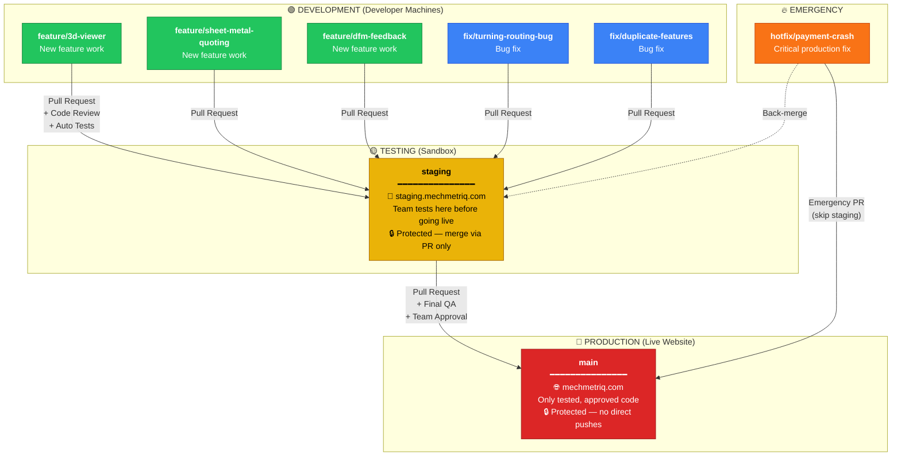
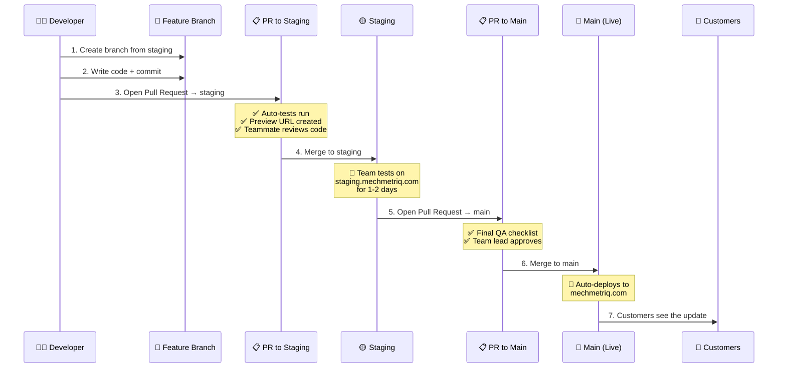
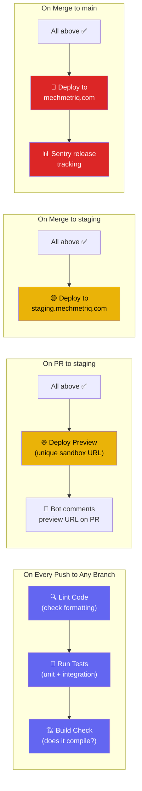
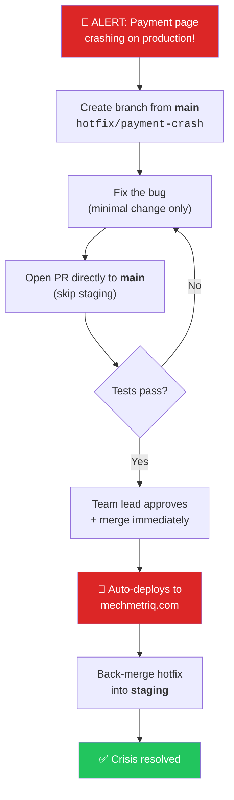

# MECHmetrIQ — Git Branching Strategy

> **For:** The MECHmetrIQ development team
> **Goal:** Never break the live website. Test everything before it goes to customers.

---

## 1. Branch Hierarchy — The Big Picture



---

## 2. How Code Flows From Developer → Live Website



---

## 3. All Branch Types Explained

### Branch Naming Convention

```
TYPE / short-description

Examples:
  feature/3d-viewer
  feature/sheet-metal-quoting
  feature/what-if-simulator
  feature/enterprise-api
  fix/turning-routing-bug
  fix/duplicate-cylinder-merge
  fix/cold-start-timeout
  hotfix/payment-gateway-crash
  chore/update-dependencies
  docs/api-documentation
```

| Branch Type | Prefix | Created From | Merges Into | Purpose | Example |
| :--- | :--- | :--- | :--- | :--- | :--- |
| **Main** | `main` | — | — | Live production website. Only tested code. | `main` |
| **Staging** | `staging` | `main` | `main` | Pre-production testing. Team QA happens here. | `staging` |
| **Feature** | `feature/` | `staging` | `staging` | New functionality (3D viewer, DFM, etc.) | `feature/dfm-feedback` |
| **Bug Fix** | `fix/` | `staging` | `staging` | Fix a known bug that's not urgent | `fix/turning-routing-bug` |
| **Hotfix** | `hotfix/` | `main` | `main` + `staging` | Emergency fix for live site (site is crashing!) | `hotfix/payment-crash` |
| **Chore** | `chore/` | `staging` | `staging` | Non-feature work (update packages, refactor) | `chore/update-cadquery` |
| **Docs** | `docs/` | `staging` | `staging` | Documentation only | `docs/api-reference` |

### Industry Standards: Commit Messages & Versioning

#### 1. Conventional Commits (v1.0.0 Standard)
Every git commit message should follow the format: `type(scope): description`
* `feat`: A new feature (e.g., `feat(smartquote): add cylindrical face coaxiality check`)
* `fix`: A bug fix (e.g., `fix(parser): resolve bounding box rotation mismatch`)
* `perf`: Performance improvement (e.g., `perf(cache): cache raw material rates in Redis`)
* `docs`: Documentation updates (e.g., `docs(capp): document turning setup calculations`)
* `chore`: Tooling / dependency updates (e.g., `chore(deps): update cadquery to 2.8`)

#### 2. Semantic Versioning (SemVer 2.0.0 Standard)
Release tags follow `vMAJOR.MINOR.PATCH` (e.g., `v1.2.4`):
* **MAJOR (`+1.0.0`):** Breaking changes or architectural shifts (e.g. migrating synchronous parser to async queue).
* **MINOR (`0.+1.0`):** New backwards-compatible features (e.g. adding 3D web viewer or DFM check).
* **PATCH (`0.0.+1`):** Backwards-compatible bug fixes and small optimizations.

---

## 4. Branch Protection Rules

Set these in **GitHub → Settings → Branches → Branch Protection Rules:**

### `main` branch (Production)
```
✅ Require pull request before merging
✅ Require at least 1 approval
✅ Require status checks to pass (tests must be green)
✅ Require branches to be up to date before merging
✅ Do NOT allow force pushes
✅ Do NOT allow deletions
```

### `staging` branch (Testing)
```
✅ Require pull request before merging
✅ Require status checks to pass (tests must be green)
☐ Approvals optional (developer can self-merge for speed)
✅ Do NOT allow force pushes
✅ Do NOT allow deletions
```

### All other branches (feature/fix/hotfix)
```
☐ No restrictions — developers can push freely
☐ Auto-deleted after PR is merged (keeps repo clean)
```

---

## 5. CI/CD Pipeline — What Happens Automatically



---

## 6. Real-World Example: Adding the 3D Viewer

```mermaid
gitgraph
    commit id: "v1.0 — current live site"
    branch staging
    checkout staging
    commit id: "staging synced with main"
    
    branch feature/3d-viewer
    checkout feature/3d-viewer
    commit id: "install three.js + react-three-fiber"
    commit id: "add glTF export to CAD worker"
    commit id: "build CadViewer3D component"
    commit id: "integrate viewer into quote page"
    commit id: "fix lighting and camera angle"
    
    checkout staging
    merge feature/3d-viewer id: "PR #14 merged ✅" type: HIGHLIGHT
    commit id: "team tests 3D viewer for 2 days"
    
    checkout main
    merge staging id: "PR #15 → PRODUCTION 🚀" type: HIGHLIGHT
    commit id: "v1.1 — 3D viewer live!"
```

---

## 7. Emergency Hotfix Flow

When the live site is broken and customers are affected:



> **Rule:** Hotfixes should be **tiny, surgical changes**. Don't use hotfixes to sneak in new features. Fix only the exact bug.

---

## 8. Developer Daily Workflow — Step by Step

### Starting New Work

```bash
# 1. Make sure you have the latest staging code
git checkout staging
git pull origin staging

# 2. Create your feature branch
git checkout -b feature/dfm-feedback

# 3. Do your work... write code, test locally
#    (use docker compose up to run everything locally)

# 4. Commit your changes (small, meaningful commits)
git add .
git commit -m "Add thin-wall DFM check with material-specific thresholds"

# 5. Push your branch to GitHub
git push origin feature/dfm-feedback

# 6. Go to GitHub → Open Pull Request → target: staging
#    → Fill in the description: what changed, why, how to test
#    → Wait for auto-tests to pass ✅
#    → Ask teammate to review (or self-merge if branch rules allow)
```

### After Your PR Is Merged to Staging

```bash
# 7. Test your changes on staging.mechmetriq.com
#    - Upload a test STEP file
#    - Check that DFM warnings appear
#    - Check that nothing else broke

# 8. When satisfied, open PR: staging → main
#    → Team lead reviews and approves
#    → Merge → automatically deploys to production 🚀

# 9. Delete your feature branch (GitHub does this automatically)
git checkout staging
git pull origin staging
git branch -d feature/dfm-feedback
```

---

## 9. Summary — The 4 Branches You Always Have

```
┌─────────────────────────────────────────────────────────┐
│                                                         │
│   🔴 main ──────────── The live website                │
│      │                  (customers use this)            │
│      │                                                  │
│   🟡 staging ────────── The testing website             │
│      │                  (team tests here)               │
│      │                                                  │
│      ├── 🟢 feature/* ── New features                   │
│      ├── 🔵 fix/* ────── Bug fixes                      │
│      └── ⚪ chore/* ──── Maintenance                    │
│                                                         │
│   🟠 hotfix/* ────────── Emergency fixes                │
│      (branches from main, merges to main + staging)     │
│                                                         │
└─────────────────────────────────────────────────────────┘
```

| Question | Answer |
| :--- | :--- |
| **How many permanent branches?** | 2 — `main` and `staging` |
| **How many temporary branches?** | As many as needed — one per task, deleted after merge |
| **Who can push to `main`?** | Nobody directly. Only via approved PR from `staging`. |
| **Who can push to `staging`?** | Nobody directly. Only via PR from feature/fix branches. |
| **How long do feature branches live?** | Days to weeks. Delete after merge. |
| **What if I need to work on 2 features at once?** | Create 2 separate branches. Keep them independent. |

---

> **Golden Rule:** Code flows in one direction:
> `feature branch` → `staging` → `main` → `customers`
>
> Never skip a step. Never push directly to `main` or `staging`.
