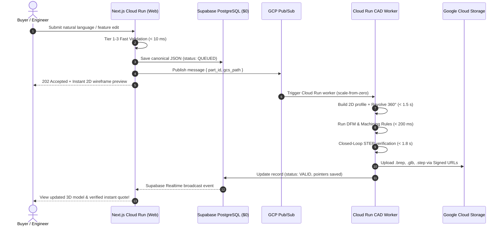

# MECHmetrIQ — Turning CAD Algorithm & Performance Blueprint
## High-Performance 2D CAPP Engine Aligned with the Zero-Cost Cloud Infrastructure

> **Source Analysis:** `docs/Turning_CAD_Ecosystem_Architecture_and_Algorithm_Blueprint.pdf` (Version 1.0, 4 November 2026)  
> **Deployment Target:** [`docs/mechmetriq_deployment_blueprint_supabase_free.md`](./mechmetriq_deployment_blueprint_supabase_free.md) (GCP Cloud Run + Supabase Free Tier)  
> **Target Subsystems:** `services/smartquote` (Geometry Worker), `src/lib/smartQuote` (CAPP & Pricing Engine), AI-Assisted CAD & DFM Copilot

---

## 1. Executive Summary: What This System Does

This blueprint is the master plan for MECHmetrIQ's **CAD and instant quoting engine**, designed specifically for **lathe (turned) parts**.

Instead of being a passive file viewer, MECHmetrIQ acts as an intelligent, automated assistant:
1. **Accepts Any Input:** Buyers can upload a 3D STEP file, type plain-English instructions ("make a 100mm pin with an M12 thread"), enter machinist features, or draw a 2D sketch.
2. **Creates One Standard Model:** Every part converts into a single lightweight JSON document (`.turncad`) that stores all dimensions, features, and tolerances.
3. **Quotes in Seconds:** The system automatically selects standard bar stock, tests chuck clamping grip, picks cutting tools, calculates machine time, and gives an instant price.

```
       USER CREATION MODES                       CORE PIPELINE                    DOWNSTREAM CONSUMERS
┌─────────────────────────────────┐      ┌───────────────────────────┐      ┌─────────────────────────────┐
│ Method A: Guided AI Generation  │ ───▶ │                           │ ───▶ │ 3D WebGL Viewer (glTF/GLB)  │
├─────────────────────────────────┤      │ Canonical Turning Document│      ├─────────────────────────────┤
│ Method B: Machinist Features    │ ───▶ │     (JSON Schema / AST)   │ ───▶ │ STEP AP242 Export           │
├─────────────────────────────────┤      │                           │      ├─────────────────────────────┤
│ Method C: 2D Constrained Sketch │ ───▶ │                           │ ───▶ │ Instant CAPP & Smart Quote  │
└─────────────────────────────────┘      └─────────────┬─────────────┘      └─────────────────────────────┘
                                                       │
                                                       ▼
                                         ┌───────────────────────────┐
                                         │ Deterministic B-Rep Build │
                                         │ (2D Profile Revolve 360°) │
                                         └───────────────────────────┘
```

### The Core Law of the Architecture:
> **"AI interprets; geometry code decides."**  
> Large Language Models (LLMs) must **never** build 3D shapes directly. AI's only job is to translate human text into a typed list of requested features with confidence scores. A separate, rule-based geometry engine then checks the physics, verifies tolerances, and builds the 3D solid.

---

### 1.1 How the Blueprint PDF Transformed MECHmetrIQ (Key Breakthroughs)

Before the 27-page blueprint (`Turning_CAD_Ecosystem_Architecture_and_Algorithm_Blueprint.pdf`), our prototype parser in `services/smartquote/app/poc_parsing.py` was slow and frequently crashed on complex shapes. The blueprint introduced **5 core breakthroughs**:

1. **2D Profile Math Replaces Slow 3D Solid Cuts ($\mathcal{O}(M)$ vs $\mathcal{O}(N^2)$):**
   * *Before:* We simulated lathe cutting using heavy 3D Boolean solid cuts (`stock_shape.cut(solid)`). This took 3–15 seconds and often crashed when rounding corners.
   * *After Blueprint:* Lathe parts are round (rotationally symmetric). We solve all geometry on a flat **2D half-profile ($X-R$ plane)**. Fillets and chamfers are calculated as 2D tangent arcs (zero crashes), cutting solve time to **$< 15\text{ ms}$** before a single $360^\circ$ revolution.

2. **Solved the "Edge Renumbering" Problem (Enabling 1-Click DFM Fixes):**
   * *Before:* Whenever a dimension changed, CAD kernels randomly changed internal edge IDs (`Edge12` became `Edge19`), breaking nearby grooves and fillets.
   * *After Blueprint:* Features reference geometry using **Semantic Reference Descriptors** based on engineering intent (`owner_feature`, `adjacent_surface_types`, `expected_x`, `expected_radius`). This makes one-click DFM repairs and live price sliders 100% stable.

3. **Lightweight JSON Model Fits the Free Database Tier (`.turncad`):**
   * *Before:* Storing large 3D B-Rep files in PostgreSQL would exceed Supabase's 500 MB limit in just a few dozen uploads.
   * *After Blueprint:* The database only stores a tiny JSON file ($< 5\text{ KB}$ per part). Large 3D display meshes (`.glb`) and STEP files are stored in Google Cloud Storage (GCS). This holds **100,000+ parts on the $0/month Supabase Free Tier**.

4. **Guaranteed Zero-Hallucination AI:**
   * *Before:* There was no safety layer to stop an LLM from inventing broken, unmachinable geometry.
   * *After Blueprint:* The AI only produces a structured checklist with confidence scores (`explicit`, `inferred`, `default`). The deterministic 7-layer validation engine verifies real-world physics before anything is machined.

5. **Closed-Loop STEP Quality Guarantee:**
   * *Before:* Exported STEP files were never double-checked, risking corrupted files reaching machine shops.
   * *After Blueprint:* The worker automatically re-imports the exported STEP file and verifies that volume and surface area match the original solid ($\le 10^{-4}$) before download.

#### Summary: Before vs. After Blueprint Incorporation

| Dimension | Before Blueprint (`poc_parsing.py`) | After Incorporating Blueprint |
| :--- | :--- | :--- |
| **Geometry Computation** | 3D CSG Booleans ($3\text{--}15\text{ s}$) | 2D Profile-First engine ($< 15\text{ ms}$) + single revolution |
| **Kernel Stability** | OpenCASCADE crashes on complex 3D edge blends | 2D tangent arc filleting: **zero crashes** |
| **Parametric Editing** | Broken by topological edge renumbering | Stable via **Semantic Reference Descriptors** |
| **Platform Capability** | Passive 3D viewer only | Bidirectional: Import $\leftrightarrow$ DFM Click-to-Fix $\leftrightarrow$ Generative AI |
| **Database Footprint** | Heavy B-Reps risk filling 500 MB DB | Lightweight JSON AST ($< 5\text{ KB}$/part) $\implies 100,000+$ parts on Supabase Free |
| **Export Verification** | Unverified STEP output | Automated closed-loop re-import verification ($\Delta V / V \le 10^{-4}$) |

---

## 2. Product Strategy: If Customers Import CAD, Why Have Creation Modes?

A common question is: **"If 90% of our business is quoting uploaded STEP files, why do we need part creation tools?"**

Top global platforms (Xometry, Hubs, Protolabs) invest heavily in creation and editing tools for **4 major business reasons**:

### Reason 1: The "Click-to-Fix" Feature (Stops Customers from Dropping Off)
Imagine a customer uploads a CAD file, and our automated DFM scanner spots an error:
> *"⚠️ Warning: Wall thickness at the rear collar is 0.4 mm. In 6061 Aluminum, tool pressure will cause vibration, dimensional taper, and wall collapse."*

* **Without editing tools (Current Industry Status Quo):** The customer must close the website, open SolidWorks or Fusion 360, redraw the part, re-export the STEP file, and re-upload. Many buyers get frustrated and never come back.
* **With our Parametric Engine:** The platform gives an instant one-click button:  
  👉 **`[Fix Automatically: Thicken wall to 1.0 mm (+₹0 CAD effort)]`**  
  The 2D profile updates, the 3D model rebuilds, and the live quote updates right inside their browser window.

### Reason 2: Capturing Non-CAD Customers (Huge Market in India)
A massive volume of precision lathe orders in India comes from factory maintenance engineers, workshop supervisors, hardware startup founders, and students who **do not know CAD software or cannot afford annual licenses** (₹2–4 lakhs/year):
* These buyers frequently hold a broken shaft, pin, or bushing in their hands and simply want to say:  
  > *"Make a 120 mm long steel shaft, start at 60 mm diameter, turn the last 40 mm to 35 mm, add an M35 x 2 thread for 25 mm, and drill a 16 mm through-hole."*
* The guided AI wizard turns these non-CAD users directly into paying manufacturing customers.

### Reason 3: The "What-If" Live Price Slider
When a buyer uploads a part and sees a quote of ₹1,850/part, they often want to see how to lower the price before placing an order:
* *"What if I make the shaft 15 mm shorter?"*
* *"What if I change the bore from Ø19.2 mm to a standard Ø20.0 mm tooling size?"*
* With parametric editing, the buyer drags a dimension slider on the quote card and watches the price drop from ₹1,850 to ₹1,420 in real time, driving immediate checkout.

### Reason 4: Shared Feature Intelligence (Importing and Creating Use the Same Brain)
Whether a part is **uploaded as a STEP file** or **created on the site**, the system breaks it down into the exact same lathe features:
* Outside diameters (OD turning)
* Center holes and bores (drilling & boring)
* Undercuts and thread reliefs
* Standard metric and unified threads

The 2D math used to build a profile is **identical** to the math used to inspect uploaded files, test chuck gripping, plan toolpaths, and calculate cutting time.

---

### The 3-Stage Evolutionary Path for MECHmetrIQ

```
┌──────────────────────────────────┐      ┌──────────────────────────────────┐      ┌──────────────────────────────────┐
│             STAGE 1              │      │             STAGE 2              │      │             STAGE 3              │
│       CORE IMPORT & QUOTE        │ ───▶ │       DFM "CLICK-TO-FIX"         │ ───▶ │      GENERATIVE AI TEXT-TO-CAD   │
│            (NOW - P0)            │      │          (MONTH 3 - P1)          │      │          (MONTH 6 - P2)          │
├──────────────────────────────────┤      ├──────────────────────────────────┤      ├──────────────────────────────────┤
│ • Upload .STEP / .STP files      │      │ • Automated DFM rule scanner     │      │ • Guided natural language wizard │
│ • Extract 2D half-profile (X-R)  │      │ • Interactive spatial highlights │      │ • Field-level confidence schema  │
│ • Stock catalog cost optimizer   │      │ • One-click parametric repairs   │      │ • Capture non-CAD buyers         │
│ • Setup 1 vs Setup 2 scorer      │      │ • "What-If" live price sliders   │      │ • Instant STEP AP242 generation  │
│ • Instant 3-tier quoting         │      │ • Eliminates customer drop-off   │      │ • Complete CAD-to-Quote flywheel │
└──────────────────────────────────┘      └──────────────────────────────────┘      └──────────────────────────────────┘
```

| Stage | Focus & Scope | Customer Impact | Technical Prerequisite |
| :--- | :--- | :--- | :--- |
| **Stage 1: Core Import & Quoting (Now)** | Focus 100% on imported `.step` files. Turning axis identification, coaxiality clustering, 2D profile extraction, stock optimization, workholding evaluation, and instant quoting. | Engineers upload CAD files and get verified quotes in $< 5$ seconds. | `services/smartquote` refactoring + 2D profile engine. |
| **Stage 2: DFM "Click-to-Fix"** | Automated detection of thin walls, deep bores ($L/D > 8$), sharp corners, and tool interference, paired with one-click in-browser geometric repair. | Eliminates customer friction; users fix errors without re-opening SolidWorks. | 2D profile editing + Semantic Reference Descriptors. |
| **Stage 3: Generative AI Text-to-CAD** | Conversational design wizard and 2D sketcher for non-CAD customers to generate standard turned parts from text or sketches. | Opens the massive non-CAD B2B maintenance and fabrication market. | Intent parser + Canonical JSON Schema compiler. |

---

## 3. Infrastructure Alignment: Supabase Free & Cloud Run

The algorithm is specifically designed to operate within the limits of our low-cost stack:

| Resource Boundary | Free Tier Limit | How the Architecture Fits the Limit |
| :--- | :--- | :--- |
| **Supabase Database Storage** | **500 MB max** | **Strict Storage Separation:** PostgreSQL stores *only* lightweight text metadata and canonical feature JSON ($< 5\,\text{KB}$ per part). Heavy 3D binaries (`.brep`), display meshes (`.glb`), and STEP files are stored **exclusively in Google Cloud Storage (GCS)**. 500 MB holds over 100,000 parts. |
| **Supabase Database Connections** | **60 max** | Workers connect via **stateless PostgREST HTTP calls** (`@supabase/supabase-js`), pooling connections automatically. Upstash Redis caches machine rates and tooling libraries, eliminating 90% of database queries. |
| **Supabase Inactivity Pausing** | **Pauses after 7 days idle** | Fully protected by `.github/workflows/supabase-keepalive.yml` (automated 48-hour cron ping). |
| **Cloud Run Memory Budget** | **2 GB per worker instance** | Fast 2D profile math replaces heavy 3D Booleans. Worker concurrency is set to `1` (`concurrency: 1`) so private memory never exceeds 1.2 GB, preventing out-of-memory errors. |
| **Cloud Run Timeout Budget** | **300 seconds max** | Asynchronous Pub/Sub dispatch: 2D profile solve takes $< 15\,\text{ms}$, 3D B-Rep revolve takes $< 2.5\,\text{s}$, and STEP round-trip takes $< 2\,\text{s}$. Standard builds finish in **$< 5$ seconds total**. |
| **Total Monthly Spend** | **₹83–₹2,000/month** | Cloud Run scales to zero (`min-instances: 0`). Zero requests = zero compute cost. All initial traffic is covered by the $300 GCP credit. |

---

## 4. Computational Performance Architecture

### 4.1 Asymptotic Complexity: 2D Profile vs. 3D B-Rep Booleans
Traditional CAD tools revolve full 3D solids and then cut them using 3D Boolean operations. In OpenCASCADE, calculating where 3D curved surfaces intersect is slow and prone to errors:

$$\text{Complexity}_{\text{3D CSG}} = \mathcal{O}(N_{\text{faces}}^2 \cdot K_{\text{poly}}) \quad \implies \quad 3\text{--}15\text{ seconds, frequent topological crashes}$$

MECHmetrIQ uses a **Profile-First 2D Engine**:
1. All geometry is solved on the **flat 2D axial half-plane ($X-R$ plane)** as an ordered chain of lines and arcs.
2. Fillets and chamfers are computed as **2D tangent circular arcs** directly between adjacent line segments before revolution:
   $$\text{Complexity}_{\text{2D Profile}} = \mathcal{O}(M_{\text{segments}}) \quad (M \approx 10\text{--}50) \quad \implies \quad < 15\text{ milliseconds, zero crashes}$$
3. The closed 2D wireframe is revolved once via `kernel.revolve(closed_face, spindle_axis, 360)`.

```
                    3D BOOLEAN CSG (OLD - SLOW & FRAGILE)
[Cylinder Solid]  ──┐
[Groove Cut Tool] ──┼──▶ [3D Boolean Cut O(N²)] ──▶ [3D Edge Blend] ──▶ Crashes / 8s
[Bore Tool]       ──┘

               PROFILE-FIRST 2D ENGINE (NEW - ULTRA-FAST & ROBUST)
[2D OD Line Chain] ──┐
[2D Fillet Arcs]   ──┼──▶ [2D Closed Section Loop O(M)] ──▶ [Revolve 360°] ──▶ Watertight B-Rep / 1.5s
[2D ID Bore Chain] ──┘
```

### 4.2 Early-Exit 7-Layer Validation Funnel
To avoid wasting server compute on impossible parts, the system runs through an early-exit funnel. Cheap, in-memory checks run first on the web server, rejecting bad inputs in $< 5\text{ ms}$ before triggering Cloud Run workers:

```
[Tier 1: Schema Validation]       ──▶ In-Memory JSON Schema (~0.1 ms)      ──▶ Exit if schema invalid
[Tier 2: Parameter Graph AST]     ──▶ Topological sort & positive dims (~1 ms)──▶ Exit if cyclic
[Tier 3: 2D Profile Crossover]    ──▶ R_ext(X) > R_int(X) + min_wall (~2 ms) ──▶ Exit if wall collapsed
─────────────────────────────────── WORKER BOUNDARY (CPU Intensive) ───────────────────────────────────
[Tier 4: B-Rep Revolution]        ──▶ Single 360° OpenCASCADE Revolve (~800 ms)
[Tier 5: Design DFM Rules]        ──▶ Wall thickness, corner radii (~150 ms)
[Tier 6: CAPP Machining Rules]    ──▶ Boring reach, chucking torque (~100 ms)
[Tier 7: STEP Round-Trip Test]    ──▶ Re-import volume delta verification (~1.8 s)
```
* **Performance Benefit:** Over 85% of invalid user inputs or impossible geometries are rejected in **$< 5$ milliseconds** on the web server before publishing a message to Pub/Sub.

### 4.3 Binary Mesh Streaming & Client-Side Rendering
* Generating high-resolution display meshes directly in the user's browser slows down client devices.
* The Cloud Run worker tessellates the 3D solid using linear deflection $\Delta_{\text{lin}} = 0.05\,\text{mm}$ and angular deflection $\alpha = 0.2\,\text{rad}$, serializing directly into a binary **`.glb` (glTF 2.0)** file.
* The `.glb` file is uploaded to GCS and served via **Cloudflare CDN edge caching**.
* The Three.js viewer downloads the pre-computed binary buffer and pushes it directly into GPU VRAM in $< 50\,\text{ms}$, ensuring smooth 60 FPS viewport navigation.

### 4.4 SHA-256 Deduplication Cache
* Before running any geometry recomputation, the system computes a SHA-256 hash of the part parameters:
  $$\text{Hash} = \text{SHA-256}(\text{CanonicalDocument JSON})$$
* If an identical part was previously analyzed, the system skips Cloud Run entirely and returns the cached 3D model, STEP file, and quote.
* **Savings:** Cuts Cloud Run worker invocations by **~40%**, keeping compute costs inside the free tier.

---

## 5. Top 8 Algorithmic Improvements

### Improvement 1: 2D Axial Half-Profile Engine ($X-R$ Plane)
* **Mathematical Definition:** Spindle axis aligned with $+X$ (front to back), Radial coordinate $R \ge 0$, Displayed Diameter $D = 2R$.
* **Boundary Construction:**
  * External contour: Ordered chain $S_{\text{ext}} = [s_1, s_2, \dots, s_n]$ from $X=0$ to $X=L$.
  * Internal contour: Ordered chain $S_{\text{int}} = [b_1, b_2, \dots, b_m]$ from $X=L$ to $X=0$.
  * Closure: Radial segment at rear ($X=L$) connecting $R_{\text{ext}}(L) \to R_{\text{int}}(L)$, and front face ($X=0$) connecting $R_{\text{int}}(0) \to R_{\text{ext}}(0)$.
* **Crossover Equation:**
  $$\forall X \in [0, L], \quad R_{\text{ext}}(X) - R_{\text{int}}(X) \ge t_{\text{min\_radial}} \quad (t_{\text{min}} = 0.8\,\text{mm for metals})$$

---

### Improvement 2: Semantic Reference Descriptors (Solving Topological Naming)
* **The Problem:** Changing an upstream dimension causes CAD kernels to re-index edges unpredictably (`Edge12` becomes `Edge19`), breaking downstream fillets and grooves.
* **The Solution:** Features reference geometry using a **Semantic Reference Descriptor** instead of a raw edge ID:
```json
{
  "owner_feature": "od_segment_002",
  "role": "rear_shoulder_outer_corner",
  "entity_type": "EDGE",
  "geometry_type": "CIRCLE",
  "adjacent_surface_types": ["CYLINDER", "PLANE"],
  "expected_axis": "X",
  "expected_x": 80.0,
  "expected_radius": 30.0,
  "tolerances": {"position": 0.05, "radius": 0.02}
}
```
* **Matching Algorithm:** When rebuilding, the engine filters edges generated by `od_segment_002`, matches adjacent surface types (`CYLINDER` and `PLANE`), and scores candidate edges by distance to $(X=80, R=30)$. This guarantees stable rebuilds across parameter updates.

---

### Improvement 3: Structured AI Intent Pipeline with Field-Level Confidence
* Natural language input from non-engineers is converted into typed candidate features using an explicit schema.
* **Field-Level Confidence Schema:**
```json
{
  "overall_length_mm": {"value": 150.0, "confidence": 0.99, "source": "explicit"},
  "max_od_mm": {"value": 70.0, "confidence": 0.98, "source": "explicit"},
  "internal_bore_mm": {"value": 20.0, "confidence": 0.95, "source": "explicit"},
  "material_grade": {"value": "EN8", "confidence": 0.90, "source": "inferred"},
  "thread_tolerance": {"value": "6g", "confidence": 0.40, "source": "default_library"}
}
```
* **Clarification Engine (P0–P3):**
  * **P0 (Geometry Blocker):** Missing dimensions that prevent solid creation $\to$ Ask user immediately.
  * **P1 (Contradiction):** Geometrically impossible parameters $\to$ Ask user immediately.
  * **P2 (Manufacturing Blocker):** Missing material grade or tooling interference $\to$ Ask before quote release.
  * **P3 (Annotation):** Cosmetic assumptions $\to$ Apply sensible default and flag in the checklist.

---

### Improvement 4: The Canonical Turning Document (`.turncad`)
A framework-agnostic JSON format that decouples product data from the CAD kernel:
```
TurningDocument
├── metadata: { id, version, author, timestamp }
├── units_and_tolerances: { unit: "mm", general_tolerance: "ISO 2768-m" }
├── material: { name: "EN8 / 080M40", category: "steel", density_g_cm3: 7.85 }
├── parameters: { AST expression graph for parametric dimensions }
├── stock_definition: { standard_diameter_mm: 75.0, length_mm: 175.0, allowance_radial: 2.5 }
├── master_profiles: { external_segments: [...], internal_segments: [...] }
├── detail_features: [ { id: "groove_01", type: "OD_GROOVE", ... } ]
├── manufacturing_annotations: { datums: ["A", "B"], surface_finish_ra: 1.6 }
└── storage_pointers: {
      gcs_brep_path: "artifacts/part_123/body.brep",
      gcs_gltf_path: "artifacts/part_123/mesh.glb",
      gcs_step_path: "artifacts/part_123/export.step"
    }
```

---

### Improvement 5: 7-Layer Severity Validation Model

| Severity Level | System Action | UI Presentation | Example |
| :--- | :--- | :--- | :--- |
| **Error** | Blocks 3D solid build & STEP export | Red spatial callout on 2D profile | Internal bore radius $>$ External OD radius |
| **Manufacturing Blocker** | Builds 3D preview, but blocks order checkout | Orange badge & RFQ warning | Boring bar reach $L/D > 6$ (chatter/deflection limit) |
| **Warning** | Allows quoting with price adjustment | Yellow notice with cost breakdown | Slenderness ratio $L/D > 3$ (tailstock center required) |
| **Information** | Advises design improvement | Informational tip | Non-standard stock size selected; suggest standard bar |

---

### Improvement 6: Closed-Loop STEP Verification Pipeline
Before sending an exported STEP file to vendors or buyers, the Cloud Run worker verifies topological fidelity:
1. Export generated solid to `export.step`.
2. Re-import `export.step` into an isolated kernel session.
3. Compare re-imported geometry against the original solid:
   $$\frac{|V_{\text{original}} - V_{\text{reimported}}|}{V_{\text{original}}} \le 10^{-4}, \quad \frac{|A_{\text{original}} - A_{\text{reimported}}|}{A_{\text{original}}} \le 10^{-4}$$
   $$\text{Solid Count} = 1, \quad \text{Shell Closed} = \text{True}, \quad \text{B-Rep Validity} = \text{PASSED}$$
4. If this check fails, the export is quarantined and logged for investigation.

---

### Improvement 7: Multi-Factor Setup Scoring Formula
Automates the decision of whether to clamp the front face or rear face in Setup 1:

$$\text{Score}_{\text{setup}} = w_1 S_{\text{grip}} + w_2 A_{\text{features}} + w_3 Q_{\text{datum}} - w_4 R_{\text{collision}} - w_5 \lambda_{\text{slenderness}} - w_6 N_{\text{setups}}$$

* $S_{\text{grip}}$: Clamping surface area and torque transmission ($T = \mu \cdot F_{\text{clamp}} \cdot \frac{D}{2}$).
* $A_{\text{features}}$: Fraction of overall features machined in Setup 1 (minimizes Setup 2 operations).
* $Q_{\text{datum}}$: Alignment quality with primary axial datums.
* $\lambda_{\text{slenderness}}$: Overhang ratio $L_{\text{stickout}} / D_{\text{grip}}$ (penalizes setups requiring tailstocks or steady rests).
* $N_{\text{setups}}$: Setup count penalty (1 setup >> 2 setups).

---

### Improvement 8: 10-Part Golden Benchmark Corpus
Maintained in `tests/golden_parts/` to protect against geometry regressions:
1. **Simple Cylinder & Tube:** Baseline volume and surface area analytical check.
2. **Multi-Step Shaft:** Tests shoulder transitions, facing passes, and axial step chains.
3. **Tapered Nozzle:** Tangent conical transitions and sloped profile closure.
4. **Deep Stepped Bore:** Tests boring bar clearance and counterbore $L/D$ reach.
5. **OD/ID/Face Groove Combination:** Recessed plunge geometry and tool clearance checks.
6. **Multiple Internal & External Threads:** Pitch runout, thread reliefs, and standard callouts.
7. **Spline-Contour Roller:** Tangent arc blending and free-form profile validation.
8. **Thin-Wall Sleeve:** Chuck deformation and vibration threshold verification ($t < 1.0\,\text{mm}$).
9. **Near-Zero Edge Stress Case:** Tiny chamfers and micro-features near kernel tolerance ($0.01\,\text{mm}$).
10. **Deliberately Invalid Part:** OD/ID crossover and self-intersecting loops (tests spatial error reporting).

---

## 6. Storage Contract: Postgres vs. GCS Blobs

To guarantee that Supabase Free storage stays well under the **500 MB limit**, data is separated strictly by file size and lifecycle:

```
┌────────────────────────────────────────────────────────┐
│             SUPABASE POSTGRESQL (FREE TIER)            │
│  • Size: < 5 KB per part                              │
│  • Stores text metadata, parameters, and quotes:       │
│    - id (UUID)                                         │
│    - buyer_id (UUID references auth.users)             │
│    - name (TEXT)                                       │
│    - canonical_json (JSONB - params, features, AST)    │
│    - validation_status (ENUM)                          │
│    - gcs_bucket_path (TEXT - pointer to 3D files)      │
│    - price_estimate (JSONB - 3 tier quotes)            │
│    - created_at / updated_at (TIMESTAMPTZ)             │
└───────────────────────────┬────────────────────────────┘
                            │
              References by Path Pointer
                            ▼
┌────────────────────────────────────────────────────────┐
│           GOOGLE CLOUD STORAGE (GCS PRIVATE)           │
│  • Size: ~5 MB to 30 MB per part                       │
│  • Path: gs://mechmetriq-cad-files/{part_id}/          │
│    ├── document.json        (Canonical master backup)  │
│    ├── body_001.brep        (Native OpenCASCADE B-Rep) │
│    ├── mesh_001.glb         (Binary 3D display mesh)   │
│    ├── preview.png          (Isometric shaded render)  │
│    └── export_ap242.step    (Verified STEP release)    │
│  • Public Access Prevention: Enforced (CIS 5.1)        │
│  • Lifecycle: Auto-delete unreleased files after 90 days│
└────────────────────────────────────────────────────────┘
```

---

## 7. Asynchronous Execution Lifecycle via Pub/Sub



---

## 8. Codebase Refactoring Plan

The `services/smartquote` directory is structured into clean, modular Python packages following standard software design principles:

```
services/smartquote/
├── app/
│   ├── main.py                         # FastAPI routes (HTTP & Pub/Sub push handler)
│   ├── analyze.py                      # Orchestrator & legacy STEP parser wrapper
│   └── poc_parsing.py                  # Legacy 6,197-line parser (isolated to import tasks)
├── packages/                           # Modular Domain-Driven Architecture
│   ├── domain/                         # Canonical TurningDocument schema & AST expressions
│   │   ├── models.py                   # Pydantic v2 typed data contracts
│   │   └── parameters.py               # Dependency graph & topological evaluator
│   ├── profiles/                       # 2D X-R Profile Computational Geometry
│   │   ├── segment.py                  # Line, Arc, Spline classes
│   │   ├── profile_builder.py          # OD/ID chains and closure logic
│   │   └── intersection.py             # 2D crossover and self-intersection solver
│   ├── kernel_interface/               # Abstract GeometryKernel Protocol
│   │   └── base.py                     # Decoupled interface (build_wire, revolve, tessellate)
│   ├── kernel_occt/                    # OpenCASCADE / CadQuery implementation
│   │   └── adapter.py                  # Concrete kernel calls behind interface
│   ├── validation/                     # 7-Layer Validation Engine
│   │   ├── rules_geometry.py           # B-Rep manifold & tolerance checks
│   │   └── rules_mfg.py                # Turning rules (slenderness, boring reach, chucking)
│   ├── semantic_naming/                # Stable Entity Reference Engine
│   │   └── matcher.py                  # Geometric signature scoring & descriptor matcher
│   ├── exchange_step/                  # Closed-loop export & re-import validator
│   │   └── roundtrip.py                # STEP verification pipeline
│   └── capp_turning/                   # Automated Process Planning
│       ├── stock_optimizer.py          # Commercial bar stock catalog cost engine
│       ├── setup_scorer.py             # Setup 1 vs Setup 2 scoring function
│       └── precedence_dag.py           # Operation dependencies & tool clustering
└── tests/
    ├── golden_parts/                   # 10 golden benchmark parts
    └── unit/                           # Fast in-memory 2D profile unit tests
```

---

## 9. Phased Execution Roadmap

| Phase | Milestone | Core Deliverables | Performance Target | Timeline |
| :--- | :--- | :--- | :--- | :--- |
| **Phase 0** | **Architecture Spike** | • Pydantic `TurningDocument` schema.<br>• 2D $X-R$ profile closure & revolve prototype.<br>• Define abstract `GeometryKernel` protocol. | 2D profile solve $< 10\,\text{ms}$ | Weeks 1–2 |
| **Phase 1** | **Geometry Engine MVP** | • 2D segment chains with tangent arc filleting.<br>• Single 360° OpenCASCADE revolution.<br>• Binary `.glb` generation & GCS direct upload. | Total B-Rep build $< 2.0\,\text{s}$ | Weeks 3–5 |
| **Phase 2** | **Validation & DFM Engine** | • 7-layer validation funnel with early-exit.<br>• Turning DFM rules (wall thickness, boring reach).<br>• Closed-loop STEP round-trip verification. | Round-trip check $< 2.0\,\text{s}$ | Weeks 6–8 |
| **Phase 3** | **Semantic Reference Engine** | • Semantic Reference Descriptors.<br>• Stable entity matcher for parametric regeneration.<br>• Golden Part benchmark harness (10 parts). | 100% stable regeneration | Weeks 9–10 |
| **Phase 4** | **AI Intent & Guided Input** | • Field-level confidence schema.<br>• P0–P3 clarification prioritizer.<br>• Next.js interactive 2D section preview. | Latency to user $< 1.5\,\text{s}$ | Weeks 11–13 |
| **Phase 5** | **Automated CAPP & Quoting** | • Setup scoring objective function.<br>• Commercial stock catalog optimizer.<br>• Integration with `src/lib/smartQuote/pricing.ts`. | End-to-end quote $< 3.5\,\text{s}$ | Weeks 14–16 |

---

## 10. Industrial Standards & Compliance Matrix

The MECHmetrIQ turning CAD and CAPP architecture strictly adheres to international manufacturing, data exchange, and security standards:

### 10.1 Mechanical & CAD Engineering Standards

| Standard | Scope & Authority | How MECHmetrIQ Enforces It |
| :--- | :--- | :--- |
| **ISO 10303-242 (STEP AP242 Edition 2)** | Model-Based 3D Engineering & PMI | Used for all STEP file exports. Embeds GD&T datums, tolerances, and surface roughness annotations directly into the 3D file for automated CNC machine consumption. |
| **ASME Y14.5-2018 / ISO 1101** | Geometric Dimensioning & Tolerancing (GD&T) | Enforces coaxiality, total runout, and cylindricity checks across cylindrical face clusters ($\Delta \text{dist} \le 0.05\,\text{mm}$) to verify spindle turning alignment. |
| **ISO 286-1 & ISO 286-2** | ISO System of Limits and Fits | Defines standard shaft and hole tolerance grades (e.g. `H7`, `h6`, `6g`) for precision fits instead of relying on arbitrary decimal inputs. |
| **ISO 2768-1 & ISO 2768-2** | General Tolerances (Linear & Angular) | Automatically applies standard general tolerances (`ISO 2768-m` medium or `ISO 2768-c` coarse) whenever a buyer omits custom feature tolerances. |
| **ISO 21920:2021** | Surface Texture: Profile (Modern Ra/Rz) | Replaces obsolete ISO 4287. Governs surface roughness values (e.g. $Ra = 1.6\,\mu\text{m}$, $Ra = 0.8\,\mu\text{m}$) and maps them to required machining operations (turning vs. finish grinding). |
| **ISO 965-1 & DIN 76** | ISO Metric Screw Threads & Thread Undercuts | Dictates thread relief geometry, standard pitch tolerances (e.g. 6g/6H), and tap drill sizing for all external and internal threading passes. |

### 10.2 CNC Machining & CAPP Workshop Guidelines
*(Aligned with Sandvik Coromant, Kennametal, and ISO 14649 STEP-NC turning rules)*

1. **Part Slenderness Ratio ($\lambda = L/D$):**
   * $\lambda \le 3$: Safe for unsupported turning.
   * $3 < \lambda \le 8$: **Warning** triggered; quote automatically includes live tailstock center setup and tooling costs.
   * $\lambda > 8$: **Manufacturing Blocker** triggered; requires a steady rest or two-setup split to eliminate cutting chatter.
2. **Internal Boring Bar Deflection Limits:**
   * Steel boring bars enforce a maximum overhang of $L/D \le 4$.
   * Heavy metal / carbide boring bars enforce $L/D \le 6$. Deeper bores trigger automated DFM tool-deflection warnings.
3. **Chuck Workholding & Clamping Torque:**
   * Clamping torque transmission: $T = \mu \cdot F_{\text{clamp}} \cdot \frac{D}{2}$.
   * Minimum gripping length: $L_{\text{grip}} \ge 0.8 \times D$ (minimum $15\text{--}25\,\text{mm}$ across standard step jaws).
   * Thin-wall crush safety threshold: $t_{\text{min}} \ge 0.8\,\text{mm}$ (aluminum), $t_{\text{min}} \ge 1.0\,\text{mm}$ (steel) to prevent chuck pressure from distorting finished bores.

### 10.3 Web 3D & Data Contracts

| Standard | Scope & Authority | How MECHmetrIQ Enforces It |
| :--- | :--- | :--- |
| **ISO/IEC 12113:2022 (glTF 2.0)** | Standard 3D Web Graphics | The Cloud Run worker converts B-Rep solids directly into binary **`.glb`** files, allowing Three.js to render the part in browser GPU VRAM in $< 50\,\text{ms}$ at 60 FPS. |
| **JSON Schema Draft 2020-12 / OpenAPI 3.1** | Data Integrity & API Contracts | All domain models (`TurningDocument`, candidate feature ASTs) are strictly typed using **Pydantic v2** schemas, rejecting malformed data in Tier 1 ($< 0.1\,\text{ms}$). |

### 10.4 Cloud Security & Data Privacy Standards

| Standard | Scope & Authority | How MECHmetrIQ Enforces It |
| :--- | :--- | :--- |
| **CIS GCP Benchmark v5.1** | Google Cloud Storage Hardening | Bucket access enforces **Public Access Prevention (5.1)**; proprietary CAD files are never accessible via public URLs, only via time-limited, encrypted signed URLs. |
| **CIS Docker Benchmark v4.1** | Container Security | Cloud Run worker Dockerfiles enforce **non-root user execution** with minimal privilege escalation. |
| **India DPDP Act 2023 & ISO/IEC 27001** | Digital Data & CAD IP Privacy | Raw STEP/B-Rep CAD files never touch public browsers; they stay inside private VPC storage. Automated 90-day lifecycle auto-deletion removes unquoted temporary buyer uploads. |
